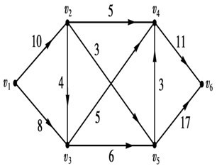
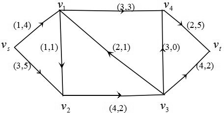

# 河南大学数学与统计学院2014～2015学年第1学期期末考试 运筹学试卷A卷

* **考试方式**：闭卷
* **考试时间**：120 分钟
* **卷面总分**：100 分

---

## 一、填空题（每题 3 分，共计 15 分）

1. 设目标函数为 $\max z = 0.5x_1 + c_2 x_2$ 的线性规划问题有两个基本最优解 $(1, 2)$ 和 $(3, 5)$，则 $c_2 =$ ______。

2. 线性规划问题

$$
\begin{aligned}
\min \quad f(x) &= 2x_1 - x_2 + 2x_3 \\
\text{s.t.} \quad &\begin{cases}
-x_1 + x_2 + x_3 = 4, \\
-x_1 + x_2 - x_3 \le 6, \\
x_1 \le 0,\ x_2 \ge 0,\ x_3 \text{ 无约束},
\end{cases}
\end{aligned}
$$

则该问题的对偶问题为：______。

3. 已知约束优化问题

$$
\begin{aligned}
\min \quad f(x) &= (x - 3)^2 \\
\text{s.t.} \quad &\begin{cases}
g_1(x) = x \ge 0, \\
g_2(x) = 5 - x \ge 0,
\end{cases}
\end{aligned}
$$

对应的拉格朗日函数为 $L(x, \lambda, \mu) = f(x) + \lambda_1 g_1(x) + \lambda_2 g_2(x)$，其中 $\lambda_1$ 和 $\lambda_2$ 为拉格朗日乘子。若假定拉格朗日函数对应的鞍点为 $(x^*, \lambda_1^*, \lambda_2^*)$，则该问题的库恩-塔克（K-T）条件为：______。

4. 在动态规划中，若令 $f(s_k)$ 表示从 $k$ 阶段的状态 $s_k$ 开始到 $n$ 阶段的终止状态的过程，$v_j(s_j, u_j)$ 表示第 $j$ 阶段的指标，$D_j^r(s_j)$ 表示第 $j$ 阶段允许决策集合。当指标函数取

$$
V_{k,n} = \prod_{j=k}^n v_j(s_j, u_j)
$$

时，动态规划逆序解法基本方程为 ______。（注：需含边界条件）。

5. 若网络图 $D = (V, A, C)$ 如下图所示：记 $v_s = v_1$ 和 $v_t = v_6$。若将 $V$ 剖分为两个非空集合 $V_1 = \{v_s, v_2, v_4\}$ 和 $\overline{V}_1 = \{v_3, v_5, v_t\}$，则对应的截量 $c(V_1, \overline{V}_1) =$ ______。

  
  
<em>图1：题5容量网络图</em>

---

## 二、判断题（对的打 √，错的打 ×。每题 2 分，共计 10 分）

6. 单纯形法计算中，若不按照最小比值原则选取换出变量，则在下一个解中至少有一个基变量的值为负。`(   )`

7. 设 $\bar{x}_j$ 和 $\bar{y}_i$ 分别为标准形式的原问题和对偶问题的可行解，$\bar{x}^*$ 和 $\bar{y}^*$ 分别为其最优解，则恒有 $\sum_{j=1}^n c_j \bar{x}_j \le \sum_{j=1}^n c_j x_j^* = \sum_{i=1}^m b_i y_i^* \le \sum_{i=1}^m b_i \bar{y}_i$。`(   )`

8. 在运输问题中，只要任意给出一组含 $(m+n-1)$ 个非零的 $\{x_{ij}\}$，且满足 $\sum_{j=1}^n x_{i,j} = a_i$ 和 $\sum_{i=1}^m x_{i,j} = b_j$，就可以作为一个初始基可行解。`(   )`

9. 用割平面法求解整数规划时，构造的割平面有可能切去一些不属于最优解的整数解。`(   )`

10. 若图中从 $v_1$ 到各点均有惟一的最短路，则连接 $v_1$ 至其它点的最短路在去掉重复部分后，恰好构成该图的最小支撑树。`(   )`

---

## 三、单项选择题（每题 3 分，共计 15 分）

11. 用大 $M$ 法求解极小化目标函数的线性规划问题时，引入人工变量之后，还需在目标函数中配上系数，这些系数值为 `(   )`

* A. 很大的正数
* B. 较小的正数
* C. 1
* D. 0

12. 影子价格的经济解释是 `(   )`

* A. 判断目标函数是否取得最优解
* B. 价格确定的经济性
* C. 约束条件所付出的代价
* D. 产品的产量是否合理

13. 在产销平衡的运输问题中，设产地为 $m$ 个，销地为 $n$ 个，则其任意一个解中基变量的个数为 `(   )`

* A. 不能大于 $m + n - 1$
* B. 不能小于 $m + n - 1$
* C. 等于 $m + n - 1$
* D. 不能确定

14. 动态规划问题中的最优策略具有性质 `(   )`

* A. 每个阶段的决策都是最优的
* B. 当前阶段以前的各阶段决策是最优的
* C. 无论初始阶段决策如何，对于先前决策所形成的状态而言，其以后所有决策应构成最优策略
* D. 它与初始状态无关

15. $\mu$ 是关于可行流 $f$ 的一条增广链，$\mu^+$ 和 $\mu^-$ 分别对应前向弧和后向弧的集合，$c_{i,j}$ 表示弧 $(v_i, v_j)$ 的容量，则在 $\mu$ 上有 `(   )`

* A. 对任意的 $(i, j) \in \mu^+$，有 $0 \le f_{ij} \le c_{ij}$
* B. 对任意的 $(i, j) \in \mu^-$，有 $0 < f_{ij} < c_{ij}$
* C. 对任意的 $(i, j) \in \mu^+$，有 $0 < f_{ij} < c_{ij}$
* D. 对任意的 $(i, j) \in \mu^-$，有 $0 < f_{ij} \le c_{ij}$

---

## 四、计算题（每题 12 分，共计 48 分）

### 16. 单纯形法与灵敏度分析

现有线性规划问题

$$
\begin{aligned}
\max \quad z &= -5x_1 + 5x_2 + 13x_3 \\
\text{s.t.} \quad &\begin{cases}
-x_1 + x_2 + 3x_3 \le 20 \\
12x_1 + 4x_2 + 10x_3 \le 90 \\
3x_1 + 2x_2 \le 18 \\
x_1 \ge 0,\ x_2 \ge 0,\ x_3 \ge 0
\end{cases}
\end{aligned}
$$

先用单纯形法求出最优解；然后分析目标函数中 $x_3$ 的系数由 $13$ 变为 $8$，最优解分别有什么变化？

---

### 17. 指派问题求解

现有 $4$ 个工人和 $4$ 件工作，每位工人做每件工作所耗时间见下表，问如何指派哪个工人完成哪项工作，可使总消耗最小？

| 工人 \ 工作 | A | B | C | D |
| :---: | :---: | :---: | :---: | :---: |
| 甲 | 2 | 15 | 13 | 4 |
| 乙 | 10 | 4 | 14 | 15 |
| 丙 | 9 | 14 | 16 | 13 |
| 丁 | 7 | 8 | 11 | 9 |

---

### 18. 动态规划求解

已知 $s_3 = 6$，$s_k$ 表示第 $k$ 阶段的状态（$k = 1, 2, 3$），用动态规划求下列最优解以及其最优值：

$$
\begin{aligned}
\max \quad z &= 3x_1 + 2x_2 + x_3^2 \\
\text{s.t.} \quad &\begin{cases}
s_{k-1} = 3s_k - x_k \\
0 \le x_k \le s_k
\end{cases}
\end{aligned}
$$

---

### 19. 最小费用最大流问题

求下列网络图最小费用最大流问题，其中弧旁的数是 $(c_{i,j}, f_{i,j})$。

  
  
<em>图2：题19最小费用最大流网络图</em>

---

## 五、证明题（共计 12 分）

### 20. 互补松弛定理证明

证明：若 $X^*$ 和 $Y^*$ 分别为线性规划原问题及其对偶问题的可行解，则 $Y^* X_S = 0$ 和 $Y_S X^* = 0$ 的充要条件为 $X^*$ 和 $Y^*$ 为最优解。（注：这里 $X_S$ 和 $Y_S$ 分别表示原问题和对偶问题中加入的松弛变量。）
