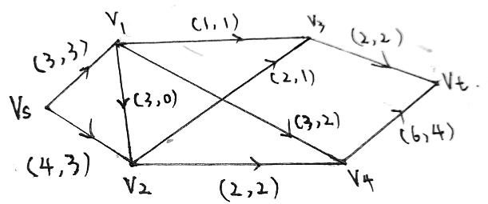

# 河南大学数学与统计学院2015～2016学年第1学期期末考试 运筹学试卷A卷 参考答案及解析

* **考试方式**：闭卷
* **考试时间**：120 分钟
* **卷面总分**：100 分

---

## 一、填空题（每题 3 分，共计 15 分）

1. 设目标函数为 $\max z = 5x_1 + c_2 x_2$ 的线性规划问题有两个基本最优解 $(1, 3)$ 和 $(2, 5)$，则 $c_2 =$ ______。

> **【参考答案】**
> $-\frac{5}{2}$（或 $-2.5$）
>
> **【解析】**
> 由于 $(1, 3)$ 和 $(2, 5)$ 均为最优解，它们对应的目标函数值必相等：
>
> $$
> 5 \times 1 + 3c_2 = 5 \times 2 + 5c_2 \implies 2c_2 = -5 \implies c_2 = -\frac{5}{2}
> $$

2. 某线性规划问题数学模型为

$$
\begin{aligned}
\min \quad d &= \sum_{j=1}^m c_j y_j \\
\text{s.t.} \quad &\begin{cases}
\sum_{j=1}^m a_{ij} y_j \ge b_i, & (i = 1, 2, \dots, n) \\
y_j \ge 0 & (j = 1, 2, \dots, m),
\end{cases}
\end{aligned}
$$

其对偶数学模型的最优解为 $X^* = (x_1^*, x_2^*, \dots, x_n^*)$，则原数学模型的最优目标函数值为 ______。

> **【参考答案】**
> $\sum_{i=1}^n b_i x_i^*$
>
> **【解析】**
> 原问题的对偶问题为 $\max z = \sum_{i=1}^n b_i x_i$，满足 $\sum_{i=1}^n a_{ij} x_i \le c_j\ (j = 1, \dots, m),\ x_i \ge 0$。由线性规划强对偶定理知，原问题的最优目标函数值等于其对偶问题的最优目标函数值，即 $d^* = \sum_{i=1}^n b_i x_i^*$。

3. 在用分支定界方法求解整数规划时，如其松弛问题得到的最优解不满足整数条件。现假定 $x_i$ 不满足整数约束条件，令 $\operatorname{int}(b_i)$ 表示不超过 $b_i$ 的最大整数，则需要构造两个约束条件 ______ 和 ______，分别将其并入到上述松弛问题中，形成两个分支，即两个后续问题。

> **【参考答案】**
> $x_i \le \operatorname{int}(b_i)$；$x_i \ge \operatorname{int}(b_i) + 1$
>
> **【解析】**
> 若松弛问题最优解中变量 $x_i = b_i$ 为非整数，则在开区间 $(\operatorname{int}(b_i), \operatorname{int}(b_i) + 1)$ 内不存在任何整数值。因此以 $x_i \le \operatorname{int}(b_i)$ 与 $x_i \ge \operatorname{int}(b_i) + 1$ 作为分支条件，既排除了当前非整数松弛解，又完整保留了所有可行整数解。

4. 在动态规划中，若令 $f(s_k)$ 表示从 $k$ 阶段的状态 $s_k$ 开始到 $n$ 阶段的终止状态的过程，$v_j(s_j, u_j)$ 表示第 $j$ 阶段的指标，$D_j^r(s_j)$ 表示第 $j$ 阶段允许决策集合。当指标函数取

$$
V_{k,n} = \prod_{j=k}^n v_j(s_j, u_j)
$$

时，动态规划逆序解法基本方程为 ______。（注：需含边界条件）。

> **【参考答案】**
>
> $$
> \begin{cases}
> f_k(s_k) = \operatorname{opt}_{u_k \in D_k^r(s_k)} \left\{ v_k(s_k, u_k) \cdot f_{k+1}(s_{k+1}) \right\}, & k = n, n-1, \dots, 1 \\
> f_{n+1}(s_{n+1}) = 1 & (\text{边界条件})
> \end{cases}
> $$
>
> （其中 $\operatorname{opt}$ 根据题意取 $\max$ 或 $\min$。）

5. 在图 $G = (V, E)$ 中，令 $p(G)$ 和 $q(G)$ 分别表示图中的顶点数和边数，则 $G$ 是一个树的充要条件是 $G$ 中不含圈，且恰有 ______ 条边。

> **【参考答案】**
> $p(G) - 1$
>
> **【解析】**
> 由树的基本等价定义，具有 $p(G)$ 个顶点的无向图 $G$ 是树的充要条件是：$G$ 中无圈（无回路）且边数 $q(G) = p(G) - 1$。

---

## 二、判断题（对的打 √，错的打 ×。每题 2 分，共计 10 分）

6. 单纯形法计算中，若不按照最小比值原则选取换出变量，则在下一个解中至少有一个基变量的值为负。`(   )`

> **【参考答案】**
> `( √ )`
>
> **【解析】**
> 最小比值原则保证了换基后新表中所有基变量取值非负；若违背最小比值原则选取了比值更大的行对应的基变量换出，则最小比值行对应的原基变量在下一表中取值必小于 $0$。

7. 设 $\bar{x}_j$ 和 $\bar{y}_i$ 分别为标准形式的原问题和对偶问题的可行解，$\bar{x}^*$ 和 $\bar{y}^*$ 分别为其最优解，则恒有 $\sum_{j=1}^n c_j \bar{x}_j \le \sum_{j=1}^n c_j x_j^* = \sum_{i=1}^m b_i y_i^* \le \sum_{i=1}^m b_i \bar{y}_i$。`(   )`

> **【参考答案】**
> `( √ )`
>
> **【解析】**
> 直接由线性规划弱对偶定理与强对偶定理可得。

8. 在运输问题中，只要任意给出一组含 $(m+n-1)$ 个非零的 $\{x_{ij}\}$，且满足 $\sum_{j=1}^n x_{i,j} = a_i$ 和 $\sum_{i=1}^m x_{i,j} = b_j$，就可以作为一个初始基可行解。`(   )`

> **【参考答案】**
> `( × )`
>
> **【解析】**
> 除满足产销约束与非负条件外，这 $m+n-1$ 个变量对应的单元格还必须**不构成闭回路**（保证对应系数向量线性无关），才能构成基可行解。

9. 用割平面法求解整数规划时，构造的割平面有可能切去一些不属于最优解的整数解。`(   )`

> **【参考答案】**
> `( × )`
>
> **【解析】**
> 割平面法构造的割平面只切去非整数的松弛最优解，不会切去任何可行的整数解。

10. 若图中从 $v_1$ 到各点均有惟一的最短路，则连接 $v_1$ 至其它点的最短路在去掉重复部分后，恰好构成该图的最小支撑树。`(   )`

> **【参考答案】**
> `( × )`
>
> **【解析】**
> 去掉重复部分后构成的是以 $v_1$ 为根的**最短路树**，并非最小支撑树（最小生成树）。

---

## 三、单项选择题（每题 3 分，共计 15 分）

11. 使用人工变量法求解极大化线性规划问题时，当所有的检验数 $\sigma_j \le 0$ 时，在基变量中仍含有非零的人工变量，表明该线性规划问题 `(   )`

* A. 有唯一的最优解；
* B. 有无穷多个最优解；
* C. 无可行解；
* D. 为无界解。

> **【参考答案】**
> `C`
>
> **【解析】**
> 当所有检验数均已满足最优性条件（$\sigma_j \le 0$），但基变量中仍存在非零的人工变量无法换出时，说明原问题的可行域为空集，即原问题**无可行解**。

12. 在目标规划中，如果要使目标规划实际实现值不超过目标值，则相应的偏离变量应满足 `(   )`

* A. $d^+ > 0$；
* B. $d^+ = 0$；
* C. $d^- = 0$；
* D. $d^+ > 0$ 且 $d^- > 0$。

> **【参考答案】**
> `B`
>
> **【解析】**
> 正偏差变量 $d^+$ 表示实际值超出目标值的部分，负偏差变量 $d^-$ 表示实际值未达到目标值的部分。要求实际实现值不超过目标值，即不允许出现正偏差，故应满足 $d^+ = 0$（在目标函数中极小化 $d^+$）。

13. 在产销平衡的运输问题中，设产地为 $m$ 个，销地为 $n$ 个，则其任意一个解中基变量的个数为 `(   )`

* A. 等于 $m + n - 1$；
* B. 不能小于 $m + n - 1$；
* C. 不能大于 $m + n - 1$；
* D. 不能确定。

> **【参考答案】**
> `A`
>
> **【解析】**
> 产销平衡运输问题约束矩阵的秩为 $m + n - 1$，因此任意基本可行解中基变量的个数恒等于 $m + n - 1$。

14. 动态规划问题中的最优策略具有性质 `(   )`

* A. 每个阶段的决策都是最优的；
* B. 当前阶段以前的各阶段决策是最优的；
* C. 无论初始阶段决策如何，对于先前决策所形成的状态而言，其以后所有决策应构成最优策略；
* D. 它与初始状态无关。

> **【参考答案】**
> `C`
>
> **【解析】**
> 此即动态规划的贝尔曼最优化原理。

15. $\mu$ 是关于可行流 $f$ 的一条增广链，$\mu^+$ 和 $\mu^-$ 分别对应前向弧和后向弧的集合，$c_{i,j}$ 表示弧 $(v_i, v_j)$ 的容量，则在 $\mu$ 上有 `(   )`

* A. 对任意的 $(i, j) \in \mu^+$，有 $0 \le f_{ij} \le c_{ij}$；
* B. 对任意的 $(i, j) \in \mu^-$，有 $0 < f_{ij} < c_{ij}$；
* C. 对任意的 $(i, j) \in \mu^+$，有 $0 < f_{ij} < c_{ij}$；
* D. 对任意的 $(i, j) \in \mu^-$，有 $0 < f_{ij} \le c_{ij}$。

> **【参考答案】**
> `D`
>
> **【解析】**
> 在增广链 $\mu$ 上，前向弧 $(i, j) \in \mu^+$ 满足 $0 \le f_{ij} < c_{ij}$（非饱和弧），后向弧 $(i, j) \in \mu^-$ 满足 $0 < f_{ij} \le c_{ij}$（非零流弧）。

---

## 四、计算题（每题 12 分，共计 48 分）

### 16. 对偶问题与单纯形法求解

对于线性规划问题

$$
\begin{aligned}
\min \quad z &= 6x_1 + 4x_2 + 7x_3 \\
\text{s.t.} \quad &\begin{cases}
x_1 + 3x_3 \ge 2 \\
3x_1 + 2x_2 + x_3 \ge 4 \\
-x_1 + 2x_2 + 2x_3 \ge 5 & (\ast) \\
x_1 \ge 0,\ x_2 \ge 0,\ x_3 \ge 0.
\end{cases}
\end{aligned}
$$

写出该问题的对偶问题并用单纯形法求其解。据此，请写出原问题 $(\ast)$ 的最优解。

> **【参考答案】**
>
> **1. 写出原问题 $(\ast)$ 的对偶问题：**
> 设对偶变量为 $y_1, y_2, y_3$，则对偶问题为：
>
> $$
> \begin{aligned}
> \max \quad w &= 2y_1 + 4y_2 + 5y_3 \\
> \text{s.t.} \quad &\begin{cases}
> y_1 + 3y_2 - y_3 \le 6 \\
> 2y_2 + 2y_3 \le 4 \\
> 3y_1 + y_2 + 2y_3 \le 7 \\
> y_1 \ge 0,\ y_2 \ge 0,\ y_3 \ge 0
> \end{cases}
> \end{aligned}
> $$
>
> **2. 用单纯形法求解对偶问题：**
> 引入松弛变量 $y_4, y_5, y_6 \ge 0$，建立单纯形表并迭代如下：
>
> | 迭代 | $C_B$ | $Y_B$ | $b$ | $y_1$ | $y_2$ | $y_3$ | $y_4$ | $y_5$ | $y_6$ | $\theta$ |
> | :---: | :---: | :---: | :---: | :---: | :---: | :---: | :---: | :---: | :---: | :---: |
> | | | $c_j$ | | $2$ | $4$ | $5$ | $0$ | $0$ | $0$ | |
> | **初始表** | $0$ | $y_4$ | $6$ | $1$ | $3$ | $-1$ | $1$ | $0$ | $0$ | — |
> | | $0$ | $y_5$ | $4$ | $0$ | $2$ | $2$ | $0$ | $1$ | $0$ | $4/2 = 2$（离基） |
> | | $0$ | $y_6$ | $7$ | $3$ | $1$ | $2$ | $0$ | $0$ | $1$ | $7/2 = 3.5$ |
> | | | $\sigma_j$ | | $2$ | $4$ | $5$（进基） | $0$ | $0$ | $0$ | |
> | **第一表** | $0$ | $y_4$ | $8$ | $1$ | $4$ | $0$ | $1$ | $1/2$ | $0$ | $8/1 = 8$ |
> | | $5$ | $y_3$ | $2$ | $0$ | $1$ | $1$ | $0$ | $1/2$ | $0$ | — |
> | | $0$ | $y_6$ | $3$ | $3$ | $-1$ | $0$ | $0$ | $-1$ | $1$ | $3/3 = 1$（离基） |
> | | | $\sigma_j$ | | $2$（进基） | $-1$ | $0$ | $0$ | $-5/2$ | $0$ | |
> | **最终表** | $0$ | $y_4$ | $7$ | $0$ | $13/3$ | $0$ | $1$ | $5/6$ | $-1/3$ | |
> | | $5$ | $y_3$ | $2$ | $0$ | $1$ | $1$ | $0$ | $1/2$ | $0$ | |
> | | $2$ | $y_1$ | $1$ | $1$ | $-1/3$ | $0$ | $0$ | $-1/3$ | $1/3$ | |
> | | | $\sigma_j$ | | $0$ | $-1/3$ | $0$ | $0$ | $-11/6$ | $-2/3$ | |
>
> 最终表中所有检验数 $\sigma_j \le 0$，故**对偶问题的最优解**为：
>
> $$
> Y^* = (y_1^*, y_2^*, y_3^*)^T = (1,\ 0,\ 2)^T, \quad \text{最优值 } w^* = 2 \times 1 + 4 \times 0 + 5 \times 2 = 12
> $$
>
> **3. 写出原问题 $(\ast)$ 的最优解：**
> 由对偶理论，原问题 $(\ast)$ 的最优解等于对偶问题最终单纯形表中松弛变量 $(y_4, y_5, y_6)$ 检验数的相反数：
>
> $$
> x_1^* = -\sigma_4 = 0, \quad x_2^* = -\sigma_5 = \frac{11}{6}, \quad x_3^* = -\sigma_6 = \frac{2}{3}
> $$
>
> 即原问题 $(\ast)$ 的最优解为 $X^* = \left(0,\ \frac{11}{6},\ \frac{2}{3}\right)^T$，最优目标函数值为 $z^* = w^* = 12$。

---

### 17. 指派问题求解

现有 $4$ 个工人和 $4$ 项工作，每人做各项目工作所消耗时间如下表所示：问如何指派使得完成工作的总消耗最小？

| 工人 \ 工作 | A | B | C | D |
| :---: | :---: | :---: | :---: | :---: |
| 甲 | 15 | 18 | 21 | 24 |
| 乙 | 19 | 23 | 22 | 18 |
| 丙 | 26 | 17 | 16 | 19 |
| 丁 | 19 | 21 | 23 | 17 |

> **【参考答案】**
>
> 采用匈牙利法求解：
>
> - **第一步：行归约**（各行分别减去该行最小值 $15, 18, 16, 17$）：
>
> $$
> \begin{pmatrix}
> 0 & 3 & 6 & 9 \\
> 1 & 5 & 4 & 0 \\
> 10 & 1 & 0 & 3 \\
> 2 & 4 & 6 & 0
> \end{pmatrix}
> $$
>
> - **第二步：列归约**（第 $2$ 列减去最小值 $1$，其余列最小值为 $0$）：
>
> $$
> \begin{pmatrix}
> 0 & 2 & 6 & 9 \\
> 1 & 4 & 4 & 0 \\
> 10 & 0 & 0 & 3 \\
> 2 & 3 & 6 & 0
> \end{pmatrix}
> $$
>
> - **第三步：第一次矩阵调整**（上表最多只有 $3$ 个独立零元素）：
>     - 覆盖第 $1, 3$ 行与第 $4$ 列（共 $3$ 条直线），未被覆盖元素位于第 $2, 4$ 行的第 $1, 2, 3$ 列，最小未覆盖元素为 $\theta_1 = 1$。
>     - 未覆盖元素减去 $1$，直线交点（$(1,4), (3,4)$）加上 $1$，得：
>
> $$
> \begin{pmatrix}
> 0 & 2 & 6 & 10 \\
> 0 & 3 & 3 & 0 \\
> 10 & 0 & 0 & 4 \\
> 1 & 2 & 5 & 0
> \end{pmatrix}
> $$
>
> - **第四步：第二次矩阵调整**（上表中第 $1, 2, 4$ 行的零元素仅分布在第 $1, 4$ 列，仍只有 $3$ 个独立零元素）：
>     - 覆盖第 $3$ 行与第 $1, 4$ 列（共 $3$ 条直线），未被覆盖元素位于第 $1, 2, 4$ 行的第 $2, 3$ 列，最小未覆盖元素为 $\theta_2 = 2$。
>     - 未覆盖元素减去 $2$，直线交点（$(3,1), (3,4)$）加上 $2$，得：
>
> $$
> \begin{pmatrix}
> 0 & 0 & 4 & 10 \\
> 0 & 1 & 1 & 0 \\
> 12 & 0 & 0 & 6 \\
> 1 & 0 & 3 & 0
> \end{pmatrix}
> $$
>
> - **第五步：确定最优指派方案与最小总消耗**：
>     - 此时存在 $4$ 个独立零元素，对应两种等价的最优指派方案：
>         - **方案一**：甲完成 B（$18$），乙完成 A（$19$），丙完成 C（$16$），丁完成 D（$17$）；
>         - **方案二**：甲完成 A（$15$），乙完成 D（$18$），丙完成 C（$16$），丁完成 B（$21$）。
>     - **最小总消耗时间**：$T_{\min} = 18 + 19 + 16 + 17 = 70$。

---

### 18. 动态规划逆序法求解

用动态规划中的逆序方法求下列问题的最优解及其最优值（注：只写最终结果无分）：

$$
\begin{aligned}
\max \quad z &= 4x_1 + 9x_2 + 2x_3^2 \\
\text{s.t.} \quad &\begin{cases}
x_1 + x_2 + x_3 = 10 \\
x_i \ge 0,\ (i = 1, 2, 3)
\end{cases}
\end{aligned}
$$

> **【参考答案】**
>
> 将问题按变量划分为 $k = 1, 2, 3$ 三个阶段，设状态变量 $s_k$ 表示第 $k$ 阶段至第 $3$ 阶段可分配的资源量，初始状态 $s_1 = 10$，状态转移方程为 $s_{k+1} = s_k - x_k\ (0 \le x_k \le s_k)$。按逆序法（$k = 3 \to 2 \to 1$）递推求解：
>
> - **第 $3$ 阶段（$k = 3$）**：
>
> $$
> f_3(s_3) = \max_{0 \le x_3 \le s_3} \{2x_3^2\} = 2s_3^2, \quad \text{最优决策 } x_3^*(s_3) = s_3
> $$
>
> - **第 $2$ 阶段（$k = 2$）**：
>
> $$
> f_2(s_2) = \max_{0 \le x_2 \le s_2} \{9x_2 + f_3(s_2 - x_2)\} = \max_{0 \le x_2 \le s_2} \{9x_2 + 2(s_2 - x_2)^2\}
> $$
>
> 由于函数 $g_2(x_2) = 2(s_2 - x_2)^2 + 9x_2$ 关于 $x_2$ 是开口向上的凸二次函数，其在闭区间 $[0, s_2]$ 上的最大值必在端点 $x_2 = 0$ 或 $x_2 = s_2$ 处取得：
> - 当 $x_2 = 0$ 时，$g_2(0) = 2s_2^2$；
> - 当 $x_2 = s_2$ 时，$g_2(s_2) = 9s_2$。
>
> 比较 $2s_2^2$ 与 $9s_2$ 可得：
>
> $$
> f_2(s_2) = \max\{2s_2^2, 9s_2\} = \begin{cases}
> 9s_2, & 0 \le s_2 \le 4.5, \quad x_2^*(s_2) = s_2 \\
> 2s_2^2, & s_2 > 4.5, \quad x_2^*(s_2) = 0
> \end{cases}
> $$
>
> - **第 $1$ 阶段（$k = 1,\ s_1 = 10$）**：
>
> $$
> f_1(10) = \max_{0 \le x_1 \le 10} \{4x_1 + f_2(10 - x_1)\}
> $$
>
> 分段讨论 $s_2 = 10 - x_1$：
> 1. 当 $5.5 \le x_1 \le 10$（即 $0 \le s_2 \le 4.5$）时：
>    $4x_1 + f_2(10 - x_1) = 4x_1 + 9(10 - x_1) = 90 - 5x_1$，在 $x_1 = 5.5$ 处取得最大值 $62.5$；
> 2. 当 $0 \le x_1 \le 5.5$（即 $4.5 \le s_2 \le 10$）时：
>    $4x_1 + f_2(10 - x_1) = 4x_1 + 2(10 - x_1)^2$，该凸函数在左端点 $x_1 = 0$ 处取得最大值 $4 \times 0 + 2 \times 10^2 = 200$。
>
> 综合比较得 $f_1(10) = 200$，此时 $x_1^* = 0 \implies s_2 = 10 \implies x_2^* = 0 \implies s_3 = 10 \implies x_3^* = 10$。
> 故该问题的**最优解**为 $(x_1^*, x_2^*, x_3^*) = (0, 0, 10)$，**最优值**为 $z^* = 200$。

---

### 19. 最大流判别与最小截量

判断下面网络图上的可行流是否是最大流，并说明理由。若是，请求出最小截量。（注：弧旁的数是 $(c_{i,j}, f_{i,j})$）。

  
  
<em>图1：题19网络流示意图</em>

> **【参考答案】**
>
> 当前源点 $v_s$ 发出的可行流流量为 $v(f) = f_{s1} + f_{s2} = 3 + 3 = 6$。用 Ford-Fulkerson 标号法检验是否存在从 $v_s$ 到 $v_t$ 的增广链：
>
> **1. 严格按标号法（含反向弧）检验：**
>
> - 给源点 $v_s$ 标号 $(+v_s, \infty)$；
> - 检查 $v_s$ 的关联弧：前向弧 $(v_s, v_1)$ 已饱和（$f_{s1} = c_{s1} = 3$），前向弧 $(v_s, v_2)$ 非饱和（$f_{s2} = 3 < c_{s2} = 4$），故给 $v_2$ 标号 $(+v_s, 1)$；
> - 检查 $v_2$ 的关联弧：前向弧 $(v_2, v_4)$ 已饱和（$f_{24} = c_{24} = 2$），反向弧 $(v_1, v_2)$ 为零流弧（$f_{12} = 0$），前向弧 $(v_2, v_3)$ 非饱和（$f_{23} = 1 < c_{23} = 2$），故给 $v_3$ 标号 $(+v_2, 1)$；
> - 检查 $v_3$ 的关联弧：前向弧 $(v_3, v_t)$ 已饱和（$f_{3t} = c_{3t} = 2$），但**反向弧 $(v_1, v_3)$ 为非零流弧**（$f_{13} = 1 > 0$），故可沿反向弧 $(v_1, v_3)$ 给 $v_1$ 标号 $(-v_3, 1)$；
> - 检查 $v_1$ 的关联弧：前向弧 $(v_1, v_4)$ 非饱和（$f_{14} = 2 < c_{14} = 3$），故给 $v_4$ 标号 $(+v_1, 1)$；
> - 检查 $v_4$ 的关联弧：前向弧 $(v_4, v_t)$ 非饱和（$f_{4t} = 4 < c_{4t} = 6$），故给汇点 $v_t$ 标号 $(+v_4, 1)$。
>
> **结论一（含反向弧增广）**：由于汇点 $v_t$ 获得标号，找到一条含反向弧 $(v_1, v_3)$ 的增广链：
>
> $$
> \mu: v_s \to v_2 \to v_3 \gets v_1 \to v_4 \to v_t, \quad \text{调整量 } \theta = 1
> $$
>
> 因此当前可行流（流量为 $6$）**不是最大流**。沿 $\mu$ 调整 $\theta = 1$ 后（$f_{s2}=4, f_{23}=2, f_{13}=0, f_{14}=3, f_{4t}=5$），源点 $v_s$ 的出弧全部饱和，达到**最大流** $v(f^*) = 7$，此时最小割集为 $V_1 = \{v_s\},\ \overline{V}_1 = \{v_1, v_2, v_3, v_4, v_t\}$（或 $V_1' = \{v_s, v_1, v_2, v_3\},\ \overline{V}_1' = \{v_4, v_t\}$），**最小截量**为：
>
> $$
> c(V_1, \overline{V}_1) = c_{s1} + c_{s2} = 3 + 4 = 7
> $$
>
> ---
>
> **2. 补充说明（若原手绘图意图中 $(v_1, v_4)$ 容量为 $2$ 或忽略反向弧 $(v_1, v_3)$）：**
> 若忽略反向弧 $(v_1, v_3)$（或原题弧 $(v_1, v_4)$ 标注为饱和弧 $(2, 2)$），则标号过程在 $v_3$ 处终止，已标号顶点集为 $V_1 = \{v_s, v_2, v_3\}$，未标号顶点集为 $\overline{V}_1 = \{v_1, v_4, v_t\}$，此时判定为最大流，对应截集 $(V_1, \overline{V}_1) = \{(v_s, v_1), (v_2, v_4), (v_3, v_t)\}$ 的截量为 $3 + 2 + 2 = 7$（若扣除反向弧 $(v_1, v_3)$ 流量 $1$ 则净流量为 $6$）。

---

## 五、证明题（共计 12 分）

### 20. 互补松弛定理证明

证明：若 $X^*$ 和 $Y^*$ 分别为线性规划原问题及其对偶问题的可行解，则 $Y^* X_S = 0$ 和 $Y_S X^* = 0$ 的充要条件为 $X^*$ 和 $Y^*$ 为最优解。（注：这里 $X_S$ 和 $Y_S$ 分别表示原问题和对偶问题中加入的松弛变量。）

> **【参考答案】**
>
> **证明：**
> 设对称形式的线性规划原问题（P）及其对偶问题（D）在引入松弛变量 $X_S \ge 0$ 与剩余变量 $Y_S \ge 0$ 后的标准型分别为：
>
> - **原问题（P）**：$\max z = C X$，满足 $A X + X_S = b$，$X \ge 0,\ X_S \ge 0$；
> - **对偶问题（D）**：$\min w = Y b$，满足 $Y A - Y_S = C$，$Y \ge 0,\ Y_S \ge 0$。
>
> 因为 $X^*$ 和 $Y^*$ 分别为原问题与对偶问题的可行解，故有：
>
> $$
> A X^* + X_S = b \quad (X^* \ge 0,\ X_S \ge 0), \qquad Y^* A - Y_S = C \quad (Y^* \ge 0,\ Y_S \ge 0)
> $$
>
> 将第一式左乘 $Y^*$，第二式右乘 $X^*$，得：
>
> $$
> Y^* A X^* + Y^* X_S = Y^* b, \qquad Y^* A X^* - Y_S X^* = C X^*
> $$
>
> 两式相减得：
>
> $$
> Y^* b - C X^* = Y^* X_S + Y_S X^*
> $$
>
> 由于 $X^* \ge 0,\ X_S \ge 0,\ Y^* \ge 0,\ Y_S \ge 0$，故 $Y^* X_S \ge 0$ 且 $Y_S X^* \ge 0$。
>
> 1. **必要性（若 $X^*, Y^*$ 为最优解 $\implies Y^* X_S = 0$ 且 $Y_S X^* = 0$）**：
>    若 $X^*$ 和 $Y^*$ 分别为原问题与对偶问题的最优解，由强对偶定理知 $C X^* = Y^* b$，故 $Y^* X_S + Y_S X^* = 0$。又因 $Y^* X_S \ge 0$ 且 $Y_S X^* \ge 0$，故必有 $Y^* X_S = 0$ 且 $Y_S X^* = 0$。
>
> 2. **充分性（若 $Y^* X_S = 0$ 且 $Y_S X^* = 0 \implies X^*, Y^*$ 为最优解）**：
>    若 $Y^* X_S = 0$ 且 $Y_S X^* = 0$，则 $Y^* b - C X^* = 0$，即 $C X^* = Y^* b$。由弱对偶定理的最优性判别准则可知，使原问题与对偶问题目标函数值相等的可行解 $X^*$ 和 $Y^*$ 必分别为原问题和对偶问题的最优解。
>
> 证毕。
