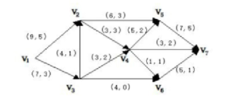

# 2022-2023学年运筹学期末考试试卷 参考答案及解析

## 一、填空题（每题 3 分，共 15 分）

1. 用对偶单纯形法进行迭代时，若 $b_i < 0$，但相应的表中的第 $i$ 行没有负元素，则该问题解的情况为 ______。

> **【参考答案】**
> 无可行解（或对偶问题具有无界解）
>
> **【解析】**
> 在对偶单纯形法中，当基变量取值 $b_i < 0$ 时需按最小比值规则从第 $i$ 行负元素中选取进基变量；若第 $i$ 行所有非基变量系数均非负（没有负元素），则无法进行换基迭代，此时对偶问题具有无界解，对应原线性规划问题**无可行解**。

2. 用表上作业法求解某运输问题，若已计算出某空格处的检验数为 $-2$，若从该空格出发用闭回路法进行调整且调整量为 $3$，则调整后总运费下降量为 ______。

> **【参考答案】**
> $6$
>
> **【解析】**
> 空格处的检验数 $\sigma_{ij} = -2$ 表示在该空格处每增加 $1$ 个单位的运量，总运费将变化 $-2$（即下降 $2$）。当沿闭回路调整量为 $\theta = 3$ 时，总运费变化量为 $\Delta z = \sigma_{ij} \times \theta = -2 \times 3 = -6$，故总运费下降量为 $6$。

3. 在用割平面方法求解整数规划问题时，最终单纯形表得到

$$
\begin{aligned}
x_1 - 0.25x_3 + 0.25x_4 &= 0.75 \\
x_2 + 0.75x_3 + 0.25x_4 &= 1.75
\end{aligned}
$$

则对应的切割方程为 ______。

> **【参考答案】**
> $-0.75x_3 - 0.25x_4 + x_5 = -0.75$（或写作不等式形式 $0.75x_3 + 0.25x_4 \ge 0.75$）
>
> **【解析】**
> 将两个约束方程中的系数与常数项均分解为整数部分与非负真分数部分之和：
>
> - 由第一行：$x_1 + (-1 + 0.75)x_3 + (0 + 0.25)x_4 = 0 + 0.75$，移项得整数部分 $x_1 - x_3 = 0.75 - (0.75x_3 + 0.25x_4)$；
> - 由第二行：$x_2 + (0 + 0.75)x_3 + (0 + 0.25)x_4 = 1 + 0.75$，移项得整数部分 $x_2 - 1 = 0.75 - (0.75x_3 + 0.25x_4)$。
>
> 两行生成的 Gomory 割平面完全相同，要求小数部分满足 $0.75 - (0.75x_3 + 0.25x_4) \le 0$，即 $-0.75x_3 - 0.25x_4 \le -0.75$。引入松弛变量 $x_5 \ge 0$ 后，切割方程为 $-0.75x_3 - 0.25x_4 + x_5 = -0.75$。

4. 当 $m$ 个产地 $n$ 个销地的运输问题为产销平衡问题时，则系数矩阵的秩为 ______。

> **【参考答案】**
> $m + n - 1$
>
> **【解析】**
> 产销平衡运输问题共有 $m + n$ 个约束方程，由于总产量等于总销量（$\sum_{i=1}^m a_i = \sum_{j=1}^n b_j$），各行约束之和等于各列约束之和，存在且仅存在一个冗余约束，因此系数矩阵的秩为 $m + n - 1$。

5. 若一棵树 $T$ 有一个点的次为 $2$，两个点的次为 $3$，三个点的次为 $4$，则它悬挂点的个数为 ______。

> **【参考答案】**
> $10$
>
> **【解析】**
> 设树 $T$ 中悬挂点（次为 $1$ 的顶点）的个数为 $k$，则树的顶点总数 $V = 1 + 2 + 3 + k = k + 6$，边数 $E = V - 1 = k + 5$。
> 由握手定理（各顶点度数之和等于边数的 $2$ 倍）得：
>
> $$
> 1 \times 2 + 2 \times 3 + 3 \times 4 + k \times 1 = 2(k + 5)
> $$
>
> 即 $20 + k = 2k + 10$，解得 $k = 10$。

---

## 二、计算题（每题 15 分，共 75 分）

### 1. 线性规划与对偶分析

已知线性规划问题

$$
\begin{aligned}
\max \quad z &= 3x_1 + 2x_2 + 3x_3 + 2x_4 \\
\text{s.t.} \quad &\begin{cases}
2x_1 + x_2 + 2x_3 + 2x_4 \le 15 \\
-x_1 + 2x_2 + 2x_3 + x_4 \le 20 \\
2x_1 + x_2 + 2x_3 + x_4 \le 16 \\
x_i \ge 0, \quad i = 1, 2, 3, 4
\end{cases}
\end{aligned}
$$

的最优单纯形表如下（其中 $x_5, x_6, x_7$ 分别为三个约束的松弛变量）：

| $C_B$ | $X_B$ | $b$ | $x_1$ | $x_2$ | $x_3$ | $x_4$ | $x_5$ | $x_6$ | $x_7$ |
| :---: | :---: | :---: | :---: | :---: | :---: | :---: | :---: | :---: | :---: |
| | $c_j$ | | | | | | | | |
| | $x_1$ | | | | | | $2/5$ | $-1/5$ | |
| | $x_2$ | | | | | | $1/5$ | $2/5$ | |
| | $x_7$ | | | | | | $-1$ | $0$ | |
| | $\sigma_j$ | | | | | | | | |

- （1）完成上面单纯形表；
- （2）指出当前的基 $B$ 以及其逆 $B^{-1}$；
- （3）写出对偶问题的最优解。

> **【参考答案】**
>
> **（1）利用矩阵关系计算单纯形表各元素：**
>
> 初始松弛变量为 $(x_5, x_6, x_7)^T$，其系数矩阵为单位矩阵 $I_3$。当前基变量为 $X_B = (x_1, x_2, x_7)^T$，故在 $x_5, x_6, x_7$ 列下的系数子矩阵即为 $B^{-1}$：
>
> $$
> B^{-1} = \begin{pmatrix}
> 2/5 & -1/5 & 0 \\
> 1/5 & 2/5 & 0 \\
> -1 & 0 & 1
> \end{pmatrix}
> $$
>
> - **右端常数列**：
>
> $$
> \bar{b} = B^{-1}b = \begin{pmatrix}
> 2/5 & -1/5 & 0 \\
> 1/5 & 2/5 & 0 \\
> -1 & 0 & 1
> \end{pmatrix} \begin{pmatrix} 15 \\ 20 \\ 16 \end{pmatrix} = \begin{pmatrix} 2 \\ 11 \\ 1 \end{pmatrix}
> $$
>
> - **非基变量 $x_3, x_4$ 的系数列**：
>
> $$
> P_3' = B^{-1}P_3 = \begin{pmatrix}
> 2/5 & -1/5 & 0 \\
> 1/5 & 2/5 & 0 \\
> -1 & 0 & 1
> \end{pmatrix} \begin{pmatrix} 2 \\ 2 \\ 2 \end{pmatrix} = \begin{pmatrix} 2/5 \\ 6/5 \\ 0 \end{pmatrix}, \quad
> P_4' = B^{-1}P_4 = \begin{pmatrix}
> 2/5 & -1/5 & 0 \\
> 1/5 & 2/5 & 0 \\
> -1 & 0 & 1
> \end{pmatrix} \begin{pmatrix} 2 \\ 1 \\ 1 \end{pmatrix} = \begin{pmatrix} 3/5 \\ 4/5 \\ -1 \end{pmatrix}
> $$
>
> - **检验数行 $\sigma_j = c_j - C_B^T P_j'$**（其中 $C_B = (3, 2, 0)^T$）：
>     - 基变量检验数：$\sigma_1 = \sigma_2 = \sigma_7 = 0$
>     - $\sigma_3 = 3 - \left(3 \times \frac{2}{5} + 2 \times \frac{6}{5} + 0\right) = -\frac{3}{5}$
>     - $\sigma_4 = 2 - \left(3 \times \frac{3}{5} + 2 \times \frac{4}{5} + 0\right) = -\frac{7}{5}$
>     - $\sigma_5 = 0 - \left(3 \times \frac{2}{5} + 2 \times \frac{1}{5} + 0\right) = -\frac{8}{5}$
>     - $\sigma_6 = 0 - \left(3 \times \left(-\frac{1}{5}\right) + 2 \times \frac{2}{5} + 0\right) = -\frac{1}{5}$
>
> 完整单纯形表如下（最优目标函数值 $z^* = 3 \times 2 + 2 \times 11 + 0 \times 1 = 28$）：
>
> | $C_B$ | $X_B$ | $b$ | $x_1$ | $x_2$ | $x_3$ | $x_4$ | $x_5$ | $x_6$ | $x_7$ |
> | :---: | :---: | :---: | :---: | :---: | :---: | :---: | :---: | :---: | :---: |
> | | $c_j$ | | $3$ | $2$ | $3$ | $2$ | $0$ | $0$ | $0$ |
> | $3$ | $x_1$ | $2$ | $1$ | $0$ | $2/5$ | $3/5$ | $2/5$ | $-1/5$ | $0$ |
> | $2$ | $x_2$ | $11$ | $0$ | $1$ | $6/5$ | $4/5$ | $1/5$ | $2/5$ | $0$ |
> | $0$ | $x_7$ | $1$ | $0$ | $0$ | $0$ | $-1$ | $-1$ | $0$ | $1$ |
> | | $\sigma_j$ | | $0$ | $0$ | $-3/5$ | $-7/5$ | $-8/5$ | $-1/5$ | $0$ |
>
> **（2）当前基 $B$ 及其逆矩阵 $B^{-1}$：**
>
> 当前基变量为 $X_B = (x_1, x_2, x_7)^T$，由原约束方程中 $x_1, x_2, x_7$ 的系数列构成基矩阵 $B$，其逆矩阵 $B^{-1}$ 为：
>
> $$
> B = \begin{pmatrix}
> 2 & 1 & 0 \\
> -1 & 2 & 0 \\
> 2 & 1 & 1
> \end{pmatrix}, \quad
> B^{-1} = \begin{pmatrix}
> 2/5 & -1/5 & 0 \\
> 1/5 & 2/5 & 0 \\
> -1 & 0 & 1
> \end{pmatrix}
> $$
>
> **（3）对偶问题的最优解：**
>
> 由对偶理论，对偶问题的最优解等于最优单纯形表中松弛变量 $(x_5, x_6, x_7)$ 检验数的相反数，即：
>
> $$
> Y^{*T} = C_B^T B^{-1} = \left(\frac{8}{5}, \frac{1}{5}, 0\right)
> $$
>
> 即对偶问题最优解为 $y_1^* = \frac{8}{5},\ y_2^* = \frac{1}{5},\ y_3^* = 0$。

---

### 2. 目标规划建模

某工厂生产 A、B、C 三种规格设备。生产工作在同一生产线上完成，三种设备装配时的工时消耗分别为 $6$、$8$ 和 $10$ 小时。生产线每月正常工作时间为 $200$ 小时。三种规格设备销售后，每台可获利分别为 $500$ 元、$650$ 元和 $800$ 元。每月销量预计为 $12$ 台、$10$ 台、$6$ 台。该厂的目标如下：

- $P_1$：每月利润指标定为 $16000$ 元；
- $P_2$：充分利用生产能力；
- $P_3$：加班时间不超过 $24$ 小时；
- $P_4$：产量以预计销量为标准（保证供应，且没有剩余）。

试建立该问题的目标规划模型。

> **【参考答案】**
>
> **1. 决策变量与偏差变量设定：**
> 设每月生产 A、B、C 三种规格设备的数量分别为 $x_1, x_2, x_3$ 台，引入正、负偏差变量 $d_i^+, d_i^- \ge 0\ (i = 1, 2, \dots, 6)$。
>
> **2. 目标约束分析：**
>
> - **$P_1$（利润指标）**：每月利润不少于 $16000$ 元，要求负偏差 $d_1^-$ 尽可能小：
>
> $$
> 500x_1 + 650x_2 + 800x_3 + d_1^- - d_1^+ = 16000
> $$
>
> - **$P_2$（充分利用正常生产能力）**：正常工作时间为 $200$ 小时，要求开工不足的负偏差 $d_2^-$ 尽可能小（其中 $d_2^+$ 表示加班工时）：
>
> $$
> 6x_1 + 8x_2 + 10x_3 + d_2^- - d_2^+ = 200
> $$
>
> - **$P_3$（加班时间不超过 $24$ 小时）**：总工时不超过 $200 + 24 = 224$ 小时（或写作 $d_2^+ + d_3^- - d_3^+ = 24$），要求超出部分的正偏差 $d_3^+$ 尽可能小：
>
> $$
> 6x_1 + 8x_2 + 10x_3 + d_3^- - d_3^+ = 224
> $$
>
> - **$P_4$（产量等于预计销量，既保证供应又无剩余）**：三种设备的正、负偏差均应尽可能小：
>
> $$
> \begin{aligned}
> x_1 + d_4^- - d_4^+ &= 12 \\
> x_2 + d_5^- - d_5^+ &= 10 \\
> x_3 + d_6^- - d_6^+ &= 6
> \end{aligned}
> $$
>
> **3. 目标规划数学模型：**
>
> $$
> \begin{aligned}
> \min \quad z &= P_1 d_1^- + P_2 d_2^- + P_3 d_3^+ + P_4 \left(d_4^- + d_4^+ + d_5^- + d_5^+ + d_6^- + d_6^+\right) \\
> \text{s.t.} \quad &\begin{cases}
> 500x_1 + 650x_2 + 800x_3 + d_1^- - d_1^+ = 16000 \\
> 6x_1 + 8x_2 + 10x_3 + d_2^- - d_2^+ = 200 \\
> 6x_1 + 8x_2 + 10x_3 + d_3^- - d_3^+ = 224 \\
> x_1 + d_4^- - d_4^+ = 12 \\
> x_2 + d_5^- - d_5^+ = 10 \\
> x_3 + d_6^- - d_6^+ = 6 \\
> x_j \ge 0 \ (j = 1, 2, 3), \quad d_i^-, d_i^+ \ge 0 \ (i = 1, 2, \dots, 6)
> \end{cases}
> \end{aligned}
> $$

---

### 3. 指派问题求解

已知五人分别完成五项工作用时如下表，请给出最优的分配方案，并求出最小用时。

| 人员 \ 任务 | A | B | C | D | E |
| :---: | :---: | :---: | :---: | :---: | :---: |
| 甲 | 18 | 15 | 19 | 18 | 21 |
| 乙 | 19 | 22 | 17 | 21 | 19 |
| 丙 | 18 | 15 | 14 | 16 | 19 |
| 丁 | 17 | 13 | 16 | 16 | 19 |
| 戊 | 14 | 16 | 17 | 15 | 21 |

> **【参考答案】**
>
> 采用匈牙利法求解该指派问题：
>
> - **第一步：行归约**（每行减去该行最小元素，各行最小值依次为 $15, 17, 14, 13, 14$）：
>
> $$
> \begin{pmatrix}
> 3 & 0 & 4 & 3 & 6 \\
> 2 & 5 & 0 & 4 & 2 \\
> 4 & 1 & 0 & 2 & 5 \\
> 4 & 0 & 3 & 3 & 6 \\
> 0 & 2 & 3 & 1 & 7
> \end{pmatrix}
> $$
>
> - **第二步：列归约**（第 $4$ 列减去 $1$，第 $5$ 列减去 $2$，其余列最小元素为 $0$）：
>
> $$
> \begin{pmatrix}
> 3 & 0 & 4 & 2 & 4 \\
> 2 & 5 & 0 & 3 & 0 \\
> 4 & 1 & 0 & 1 & 3 \\
> 4 & 0 & 3 & 2 & 4 \\
> 0 & 2 & 3 & 0 & 5
> \end{pmatrix}
> $$
>
> - **第三步：试指派与矩阵调整**：
>     - 在上表中最多只能找到 $4$ 个独立零元素（例如 $(1,2), (2,5), (3,3), (5,1)$，第 $4$ 行的零元素位于第 $2$ 列冲突）。
>     - 作最少覆盖零元素的直线（覆盖第 $2, 3, 5$ 行与第 $2$ 列，共 $4$ 条直线），未被覆盖元素位于第 $1, 4$ 行的第 $1, 3, 4, 5$ 列，其中最小元素为 $\theta = 2$。
>     - 将未被覆盖的第 $1, 4$ 行各减去 $2$，直线交点所在的第 $2$ 列加上 $2$，得到变换后的效率矩阵：
>
> $$
> \begin{pmatrix}
> 1 & 0 & 2 & 0 & 2 \\
> 2 & 7 & 0 & 3 & 0 \\
> 4 & 3 & 0 & 1 & 3 \\
> 2 & 0 & 1 & 0 & 2 \\
> 0 & 4 & 3 & 0 & 5
> \end{pmatrix}
> $$
>
> - **第四步：确定最优指派方案与最小用时**：
>     - 此时可找到 $5$ 个独立零元素，存在两种等价的最优分配方案：
>         - **方案一**：甲完成 B（$15$），乙完成 E（$19$），丙完成 C（$14$），丁完成 D（$16$），戊完成 A（$14$）；
>         - **方案二**：甲完成 D（$18$），乙完成 E（$19$），丙完成 C（$14$），丁完成 B（$13$），戊完成 A（$14$）。
>     - **最小总用时**：$T_{\min} = 15 + 19 + 14 + 16 + 14 = 78$。

---

### 4. 动态规划求解非线性规划

用动态规划递推法求解如下非线性规划问题：

$$
\begin{aligned}
\max \quad z &= 2x_1^2 + 9x_2 + 4x_3 \\
\text{s.t.} \quad &\begin{cases}
x_1 + x_2 + x_3 = 20 \\
x_1, x_2, x_3 \ge 0
\end{cases}
\end{aligned}
$$

> **【参考答案】**
>
> 将问题按变量下标划分为 $k = 1, 2, 3$ 三个阶段，设状态变量 $s_k$ 表示第 $k$ 阶段至第 $3$ 阶段可分配的资源总量，其中初始状态 $s_1 = 20$，状态转移方程为 $s_{k+1} = s_k - x_k\ (0 \le x_k \le s_k)$。采用逆序递推法求解：
>
> - **当 $k = 3$ 时**：
>
> $$
> f_3(s_3) = \max_{0 \le x_3 \le s_3} \{4x_3\} = 4s_3, \quad \text{最优决策 } x_3^*(s_3) = s_3
> $$
>
> - **当 $k = 2$ 时**：
>
> $$
> \begin{aligned}
> f_2(s_2) &= \max_{0 \le x_2 \le s_2} \{9x_2 + f_3(s_2 - x_2)\} \\
> &= \max_{0 \le x_2 \le s_2} \{9x_2 + 4(s_2 - x_2)\} = \max_{0 \le x_2 \le s_2} \{5x_2 + 4s_2\} = 9s_2
> \end{aligned}
> $$
>
> 此时最优决策为 $x_2^*(s_2) = s_2$（对应 $s_3 = s_2 - x_2^* = 0$）。
>
> - **当 $k = 1$ 时（$s_1 = 20$）**：
>
> $$
> \begin{aligned}
> f_1(20) &= \max_{0 \le x_1 \le 20} \{2x_1^2 + f_2(20 - x_1)\} \\
> &= \max_{0 \le x_1 \le 20} \{2x_1^2 + 9(20 - x_1)\} = \max_{0 \le x_1 \le 20} \{2x_1^2 - 9x_1 + 180\}
> \end{aligned}
> $$
>
> 由于二次函数 $g(x_1) = 2x_1^2 - 9x_1 + 180$ 开口向上（凸函数），在闭区间 $[0, 20]$ 上的最大值必在端点处取得：
> - 当 $x_1 = 0$ 时，$g(0) = 180$；
> - 当 $x_1 = 20$ 时，$g(20) = 2 \times 20^2 - 9 \times 20 + 180 = 800$。
>
> 比较可得 $f_1(20) = 800$，此时 $x_1^* = 20$，从而 $s_2 = 20 - 20 = 0 \implies x_2^* = 0,\ x_3^* = 0$。
> 故该问题的最优解为 $(x_1^*, x_2^*, x_3^*) = (20, 0, 0)$，最优目标函数值为 $z^* = 800$。

---

### 5. 网络最大流问题

下图为一网络，网络中每条弧上的数字为该条弧的（容量，流量）。求该网络 $v_1$ 到 $v_7$ 的最大流和最大流量。（要求仅迭代一次并指出增广链和调整量）

  
  
<em>图1：网络最大流问题示意图</em>

> **【参考答案】**
>
> **1. 初始流量分析：**
> 由图可知，当前可行流从源点 $v_1$ 发出的总流量为 $v(f) = f_{12} + f_{13} = 5 + 3 = 8$。
>
> **2. 单次标号迭代（寻找一条增广链及调整量）：**
>
> - **取增广链 $\mu_1: v_1 \to v_3 \to v_6 \to v_7$**：
>     - 各前向弧上的剩余容量依次为：$c_{13} - f_{13} = 7 - 3 = 4$，$c_{36} - f_{36} = 4 - 0 = 4$，$c_{67} - f_{67} = 5 - 1 = 4$。
>     - **调整量**：$\theta_1 = \min\{4, 4, 4\} = 4$。
>     - 调整后弧 $(v_1, v_3)$、$(v_3, v_6)$、$(v_6, v_7)$ 的流量分别变为 $7, 4, 5$，网络流量增至 $8 + 4 = 12$。
> - （注：若第一次迭代选取增广链 $\mu_2: v_1 \to v_2 \to v_5 \to v_7$，则对应调整量为 $\theta_2 = \min\{9-5, 6-3, 7-5\} = 2$，调整后流量增至 $8 + 2 = 10$。）
>
> **3. 完整最大流求解（补充完整迭代至最大流）：**
>
> - 在沿 $\mu_1$ 增广（流量为 $12$）的基础上，继续沿增广链 $\mu_2: v_1 \to v_2 \to v_5 \to v_7$ 调整 $\theta_2 = 2$，流量增至 $12 + 2 = 14$；
> - 再沿含反向弧的增广链 $\mu_3: v_1 \to v_2 \to v_5 \gets v_4 \to v_7$（其中 $(v_4, v_5)$ 为反向弧，$f_{45} = 2 > 0$）调整 $\theta_3 = \min\{9-7, 6-5, 2, 3-2\} = 1$，此时汇点 $v_7$ 的所有入弧 $(v_5, v_7), (v_4, v_7), (v_6, v_7)$ 全部达到饱和（流量分别为 $7, 3, 5$）。
> - **最大流量**：$v(f^*) = 7 + 3 + 5 = 15$，各弧最终最大流为：
>     - $f_{12}^* = 8,\ f_{13}^* = 7$；
>     - $f_{24}^* = 3,\ f_{25}^* = 6,\ f_{32}^* = 1,\ f_{34}^* = 2,\ f_{36}^* = 4$；
>     - $f_{45}^* = 1,\ f_{46}^* = 1,\ f_{47}^* = 3,\ f_{57}^* = 7,\ f_{67}^* = 5$。

---

## 三、问答题（共 10 分）

1. 在学习过运筹学后，您认为学到的最重要的方法是什么？并列出理由。

> **【参考答案】**
>
> 本题为开放性论述题，可围绕运筹学的核心方法（如**单纯形法与对偶理论**、**动态规划的贝尔曼最优化原理**、或**数学建模与系统优化思想**）展开作答。以下提供以“单纯形法与对偶理论”为例的标准作答要点：
>
> - **核心方法**：线性规划中的**单纯形法（Simplex Method）与对偶理论（Duality Theory）**。
> - **主要理由**：
>     1. **奠定现代优化算法的理论基石**：单纯形法利用凸多面体极点（基本可行解）的代数特征，将连续无穷维搜索转化为有限步极点迭代，并结合“检验数判优”与“最小比值保可行”两大准则，体现了最优化算法构造的基本范式。
>     2. **揭示优化问题的内在对称性与经济含义**：对偶理论与互补松弛定理不仅提供了对偶单纯形法等高效求解工具，更赋予了拉格朗日乘子深刻的经济学解释（影子价格），为资源配置与灵敏度分析提供了科学依据。
>     3. **广泛的扩展性与通用性**：整数规划中的分支定界法与割平面法、目标规划的序贯单纯形法以及网络流问题中的网络单纯形法，均以线性规划单纯形法及对偶理论为基础。
